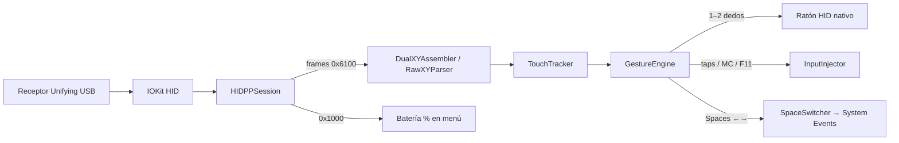

# Hidex

**[Español](#español)** · **[English](#english)**

> Idioma de la documentación en GitHub: español primero, luego inglés.  
> En la app: si el idioma preferido del macOS empieza por `en` → inglés; **en cualquier otro caso → español**.

Gestos multitouch en **espacio de usuario** para touchpads inalámbricos **HID++** en macOS (Apple Silicon e Intel).

**Hardware compatible documentado:** Logitech Wireless Rechargeable Touchpad **T650** + receptor Unifying.  
**No afiliado a Logitech ni a Apple.** Marca propia: [Docs/BRAND.md](Docs/BRAND.md).

[](LICENSE)
[](CHANGELOG.md)
[](#requisitos)
[](#compilar)

---

## Español

### ¿Qué es Hidex?

macOS trata muchos touchpads Logitech Unifying como un ratón básico: mover y hacer clic, **sin** gestos de Mission Control / Spaces como en un Magic Trackpad. Hidex habla **HID++ 2.0**, activa informes multitouch raw (`TouchPadRawXY` `0x6100`) y traduce gestos a acciones del sistema **sin kext**.

### Características

| Gesto | Acción por defecto |
|--------|---------------------|
| 1 dedo mover | Puntero nativo (modo dual HID++) |
| Toque 1 dedo | Clic izquierdo *(configurable)* |
| Doble toque 1 dedo | Maximizar ventana (rellena pantalla) |
| 2 dedos | Scroll nativo |
| Toque 2 dedos | Clic derecho *(umbrales estrictos vs scroll)* |
| 3 dedos ↑ | Mission Control (abrir) |
| 3 dedos ↓ | Cerrar Mission Control |
| 3 / 4 dedos ←→ | Cambiar Spaces |
| 4 dedos ↑ | Escritorio (F11) |
| 4 dedos ↓ | Launchpad o App Exposé |
| Clic físico | Botón del pad (HID nativo) |

Extras: icono de menú tipo **touchpad**, **% de batería en el menú**, preferencias, Gesture Lab, inicio al encender. Compatible con teclado Unifying (p. ej. MX Keys) en el mismo receptor.

### Icono de la barra de menú

No es un icono genérico de “batería del Mac”. Hidex dibuja una **silueta de touchpad** (con contactos multitouch y una barra de carga). El **porcentaje** y la **versión** (`Hidex 2.0.5 (9)`) están en el menú al hacer clic.

### Requisitos

- macOS **13+**
- Touchpad compatible (perfil documentado: **T650**, WPID `0x4101`) + receptor Unifying (`0xC52B` típico)
- Permisos:
  1. **Accesibilidad** → Hidex  
  2. **Automatización** → Hidex → **System Events**  
  3. Atajos de Mission Control (mover espacio izq/der) activos

### Instalación (usuario)

1. Descarga `Hidex-*-universal.dmg` o `.pkg` desde [Releases](https://github.com/jimmks7/Hidex/releases).
2. Arrastra a **Aplicaciones** (DMG) o ejecuta el PKG.
3. **Gatekeeper / firma**
   - Los binarios de release **no están notarizados** con Apple Developer ID (coste de cuenta de desarrollador).
   - En el primer arranque: *Privacidad y seguridad → Abrir de todas formas*.
   - Opcional (desarrolladores / usuarios avanzados): tras instalar, genera una **autofirma local estable** en *tu* Mac para que Accesibilidad no se rompa entre rebuilds:

```bash
./scripts/self-sign-installed.sh
```

   Eso **no** sustituye la notarización de Apple ante Gatekeeper en otra máquina; solo crea la identidad **Hidex Local** en el llavero del instalador.

4. Concede Accesibilidad + Automatización → System Events.
5. Menú → **Reiniciar app**.

### Uso diario

1. Conecta el Unifying y enciende el touchpad.  
2. Abre **Hidex** (icono touchpad en la barra de menú; batería dentro del menú).  
3. Ajusta gestos en **Preferencias…**  
4. Si Spaces fallan: **Diagnosticar Spaces…** / **Gesture Lab**.  
5. Log: `~/.hidex.log`  
6. Versión: al final del menú o diálogo Acerca de.

### Cómo funciona (implementación)



1. **Detección:** localiza el receptor Unifying y el dispositivo emparejado (WPID documentado `0x4101`).  
2. **Raw multitouch:** `SET_RAW` con flags dual (`0x15`) → eventos XY + movimiento/scroll nativos para 1–2 dedos.  
3. **Clasificación:** `GestureEngine` usa el `finger_count` del frame al disparar (3 vs 4), no solo el pico.  
4. **Mission Control:** lanza `Mission Control.app` (no necesita Automatización).  
5. **Spaces:** System Events (`⌃←` / `⌃→`); los `CGEvent` sintéticos de Ctrl+flecha suelen ser ignorados por WindowServer en macOS reciente.  
6. **Batería:** feature HID++ `0x1000` (a veces nivel grueso).

Detalle de protocolo: [Docs/PROTOCOL.md](Docs/PROTOCOL.md) · checklist Spaces: [Docs/SPACES_CHECKLIST.md](Docs/SPACES_CHECKLIST.md).

### Compilar

```bash
git clone https://github.com/jimmks7/Hidex.git
cd Hidex
./install.sh                     # nativo → /Applications
./scripts/package-installer.sh   # universal → dist/
```

Versión fuente de verdad: archivo [`VERSION`](VERSION) + [`CHANGELOG.md`](CHANGELOG.md) ([Keep a Changelog](https://keepachangelog.com/) + SemVer).

### Licencia y terceros

- Código: **[MIT](LICENSE)** (texto legal en inglés; [traducción ES](LICENSE.es.md))  
- Atribuciones: [NOTICE.md](NOTICE.md) · notas: [LEGAL.md](LEGAL.md)  
- Referencia de comportamiento (sin copiar código): Solaar (GPL), libratbag (MIT), docs HID++ públicas  
- **Publicación pública: permitida** con estas atribuciones y sin redistribuir binarios propietarios de Logitech

### Autor

[@jimmks7](https://github.com/jimmks7) — aporte a la comunidad de quien sigue usando touchpads Unifying en Mac.

---

## English

### What is Hidex?

macOS often exposes Logitech Unifying touchpads as a basic mouse: move and click, **without** Magic Trackpad–style Mission Control / Spaces gestures. Hidex speaks **HID++ 2.0**, enables raw multitouch reports (`TouchPadRawXY` `0x6100`), and maps gestures to system actions — **no kernel extension**.

### Features

| Gesture | Default action |
|---------|----------------|
| 1-finger move | Native pointer (dual HID++ mode) |
| 1-finger tap | Left click *(configurable)* |
| 1-finger double-tap | Maximize window (fill screen) |
| 2 fingers | Native scroll |
| 2-finger tap | Right click *(strict thresholds vs scroll)* |
| 3-finger ↑ | Mission Control (open) |
| 3-finger ↓ | Dismiss Mission Control |
| 3 / 4-finger ←→ | Switch Spaces |
| 4-finger ↑ | Show Desktop (F11) |
| 4-finger ↓ | Launchpad or App Exposé |
| Physical click | Pad button (native HID) |

Extras: **touchpad-style** menu icon, **battery % in the menu**, preferences, Gesture Lab, launch at login. Works alongside a Unifying keyboard (e.g. MX Keys) on the same receiver.

### Menu bar icon

Not a generic Mac “battery” glyph. Hidex draws a **touchpad silhouette** (multitouch contacts + charge bar). Battery **percentage** and **version** (`Hidex 2.0.5 (9)`) live in the menu.

### Requirements

- macOS **13+**
- Compatible touchpad (documented profile: **Logitech T650**, WPID `0x4101`) + Unifying receiver
- Permissions: **Accessibility**, **Automation → System Events**, Mission Control space-switch shortcuts enabled

### Install

1. Download `Hidex-*-universal.dmg` / `.pkg` from [Releases](https://github.com/jimmks7/Hidex/releases).  
2. Drag to Applications or run the PKG.  
3. **Signing / Gatekeeper:** release builds are **not Apple-notarized**. Use *Open Anyway*. Optional local resign for stable Accessibility on *your* machine: `./scripts/self-sign-installed.sh` (does **not** replace notarization for other Macs).  
4. Grant Accessibility + Automation.  
5. Menu → **Relaunch app**.

### Daily use

Connect Unifying → power the pad → run Hidex → tune **Preferences…** → diagnose with Gesture Lab if needed → log at `~/.hidex.log`.

### Architecture

Same diagram as above (Mermaid). Protocol notes: [Docs/PROTOCOL.md](Docs/PROTOCOL.md).

### Build

```bash
git clone https://github.com/jimmks7/Hidex.git
cd Hidex
./scripts/package-installer.sh
```

Versioning: [`VERSION`](VERSION) + [`CHANGELOG.md`](CHANGELOG.md) (Keep a Changelog + SemVer).

### License

- **[MIT](LICENSE)** (canonical English legal text; [Spanish informative translation](LICENSE.es.md))  
- Third-party credits: [NOTICE.md](NOTICE.md) · [LEGAL.md](LEGAL.md)  
- Public GitHub distribution is appropriate when attributions are kept and no proprietary Logitech binaries are shipped

### Author

[@jimmks7](https://github.com/jimmks7)
